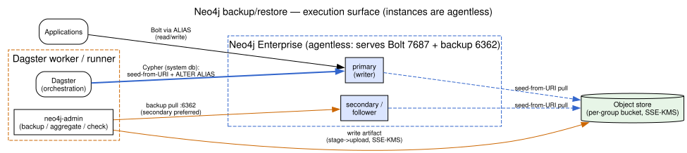
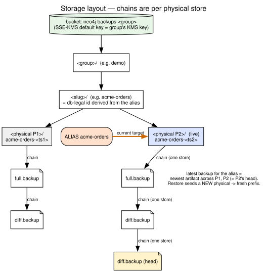
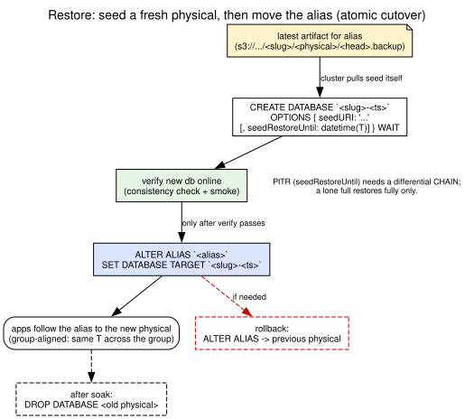
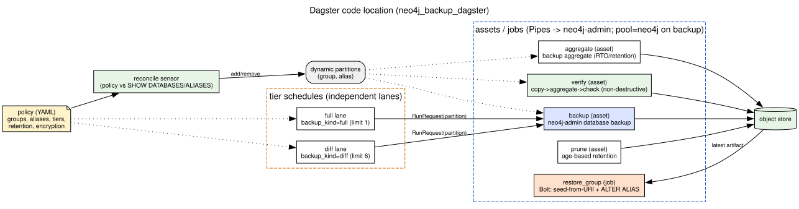
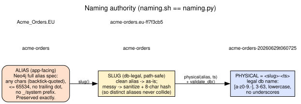

# Diagrams

Graphviz (`.dot`) sources, rendered to SVG. Regenerate with `just diagrams` (from the
repo root) or `./render.sh` here. Both need graphviz (`brew install graphviz`).

## Architecture: execution surface

Neo4j servers stay agentless: the runner runs `neo4j-admin` backups, restores use Cypher, and
servers pull seeds. Source: [`architecture.dot`](architecture.dot).

## Storage layout

`<group>/<slug>/<physical>/<artifact>.backup` and the per-store backup chains. Source:
[`storage-layout.dot`](storage-layout.dot).

## Restore cutover

Seed a new physical, verify, `ALTER ALIAS`, then rollback or cleanup. Source:
[`restore-cutover.dot`](restore-cutover.dot).

## Dagster pipeline

The code location: the backup, aggregate, verify and prune assets and the restore job.
It also shows the schedules and the reconciliation sensor. Source: [`dagster-pipeline.dot`](dagster-pipeline.dot).

## Naming authority

`alias -> slug -> physical`, the same rules in `naming.sh` and `naming.py`. Source:
[`naming.dot`](naming.dot).

---

The SVGs are generated; re-render after editing a `.dot`.
